# LES BASES DE GIT

## Plan du cours

### [▶️ Slides du cours](https://docs.google.com/presentation/d/e/2PACX-1vRRJo_SUd24189nq2HBysZd9d57d1zRqks2vDCfBzDls6nqOySY3uGVHbR_SQlU3Rc3ibb8W4eV1Ipj/pub?start=false&loop=false&delayms=3000)

> 1. [Git](#git) : Comment & pourquoi utiliser le _versioning_
> 2. [Installer et configurer Git](#exercice-1--installer-et-configurer-git)
> 3. [IDE](#utiliser-un-ide) : Prise en main d’un logiciel de développement
> 4. [Premier commit](#création-de-son-premier-commit) : `init`, `status`, `diff`, `add`, `commit`, `log`
> 5. [Remonter le temps](#remonter-le-temps) : `restore`, `show`
> 6. [Les branches](#les-branches) : `branch`, `switch`
> 7. [La fusion de branches](#la-fusion-de-branches) : `merge`, `rebase`
> 8. [Les conflits](#les-conflits)
> 9. [Récapitulatif](#ce-que-vous-savez-faire-maintenant)

<hr>

## Git

> **GIT ?!**

`git` est un outil de gestion de versions décentralisé créé par Linus Torvalds 
(le même que Linux) en 2005 sous licence open-source GPL (version 2)

<hr>

### À quoi ça sert le _versioning_ ?

1. **_Sauvegarder des versions_** : Git permet de créer des instantanés du contenu d’un dossier
2. **_Conserver un historique_** : En sauvegardant des versions successives, on a accès à la liste de toutes les modifications
3. **_Créer des états parallèles_** : Possibilité de disposer de plusieurs versions simultanées d’un dossier
4. **_Collaborer sur un projet_** : Les contributions effectuées sur un même fichier peuvent être fusionnées

<hr>

#### 1️⃣ Sauvegarder des versions

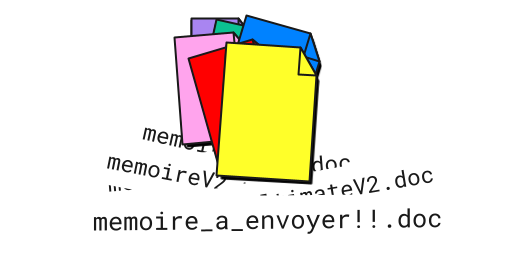

Avec git, en plus de sauvegarder normalement vos fichiers, vous pouvez décider de **capturer des états donnés** d’un de vos dossiers.

Un dossier dont vous enregistrez des versions se nomme _**`repository`**_.

Une sauvegarde de ce repository est nommée _**`commit`**_.

<hr>

#### 2️⃣ Conserver un historique

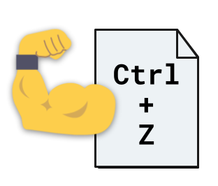

Un Ctrl+Z qui peut revenir 2 ans en arrière, savoir qui a fait la modif et pourquoi.

Chaque _**`commit`**_ conserve en mémoire :

- sa date de création
- les lignes précises où les fichiers ont été édités
- un message expliquant le but des modifications
- la personne qui l’a effectué

En remontant les _commits_ successifs, il est possible de suivre précisément l’évolution d’un _repository_ et de revenir à un état précédent au besoin.

<hr>

#### 3️⃣ Créer des états parallèles

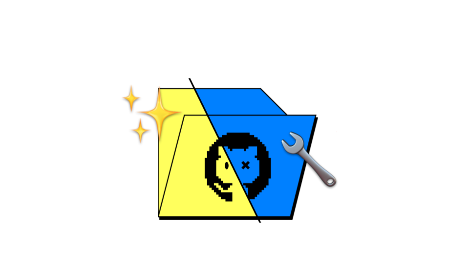

Il est possible de faire coexister différentes versions des fichiers contenus dans un _repository_ :
ces versions sont appelées _**`branches`**_.

Les _**`branches`**_ permettent de faire cohabiter de multiples états d’avancement d’un projet et 
de se lancer dans des modifications sans casser l’existant.

La branche par défaut s’appelle _**`main`**_ (anciennement _**`master`**_).

<hr>

#### 4️⃣ Collaborer sur un projet


Comme système de version décentralisé, `git` permet de :

- travailler sur un même projet avec plusieurs personnes, chacun depuis son ordinateur
- réconcilier les historiques pour mettre en commun les modifications effectuées sur différentes _**`branches`**_.

Les _**`branches`**_ peuvent ensuite être fusionnées : 
on parle de _**`merge`**_ ou de _**`rebase`**_.

<hr>

### Exercice 1 : Installer et configurer `git`

**Initialisation de git**
```bash
# Ouvrir son terminal (Ctrl+Alt+T sur Ubuntu)

# Mise à jour des dépendances système
sudo apt-get update # Mac: brew update (nécessite Homebrew : https://brew.sh)

# Installation de git
sudo apt install git # Mac: brew install git

# Vérifier l’installation
git --version
```

[Correction](./exercices/exercice1.sh)

<hr>

**Configuration de l’utilisateur Git**

```bash
# Définition de l’utilisateur (⚠️ même que sur GitHub)
git config --global user.name "<github-user>"
git config --global user.email "<github-email>"

# Par exemple (⚠️ retirer les chevrons)
git config --global user.name "Segolene-Albouy"
git config --global user.email "segolene.albouy@mail.com"

# Nous verrons plus tard comment lier son compte Git local avec son compte GitHub

# ⚠️ À REFAIRE POUR CHAQUE NOUVEL ORDINATEUR
```

<hr>

**Configuration de git**

```bash
# Définition de l’éditeur par défaut
git config --global core.editor "nano"

# Définition du nom de la branche par défaut
git config --global init.defaultBranch main

# Configuration de la coloration par défaut
git config --global color.ui auto

# Choix de merge comme mode de fusion lors d’un pull
# (pull sera vu au cours 2)
git config --global pull.rebase false

# Afficher vos configurations
git config --list
# ✅ RÉUSSI si `user.name` et `user.email` sont affichés
```

<hr>

#### Modification du `.bashrc`

Le `.bashrc` est un fichier de configuration qui permet de personnaliser son terminal bash.

```bash
# installer curl si nécessaire
sudo apt install curl

# sauvegarder le .bashrc actuel avant toute modification
cp ~/.bashrc ~/.bashrc.bak

# ajout de commandes et alias à sa config bash
curl -s https://raw.githubusercontent.com/Segolene-Albouy/GIT-M2TNAH/refs/heads/main/01-Git_basics/templates/.bashrc >> ~/.bashrc

# recharger la config pour voir les effets
source ~/.bashrc

# SI BESOIN DE RÉTABLIR L'ANCIEN BASHRC
# cp ~/.bashrc.bak ~/.bashrc
```

Avec l'ajout de ces commandes, vous pouvez désormais :

```bash
# Voir immédiatement la branche courante
user:/path/to/repo [branch] $ 

# Changer votre .bashrc facilement avec la commande
# Notamment pour changer les couleurs 🎨
bashrc

# Visualiser la diff entre la branche locale/remote
gdiff

# Afficher les logs bien formatés
glog
```

<hr>

## Utiliser un IDE

> 💡 Toute la suite du cours se pratique **dans VSCode** : les commandes sont tapées dans le terminal intégré,
> et le panneau _Source Control_ permet de **voir** en direct l’effet de chaque commande.

### Qu'est-ce qu'un IDE ?

Un IDE (_Integrated Development Environment_) est un logiciel qui facilite le développement de code :
- éditeur de texte avec coloration syntaxique
- terminal intégré
- navigation dans les fichiers
- plugins pour ajouter des fonctionnalités
- etc.

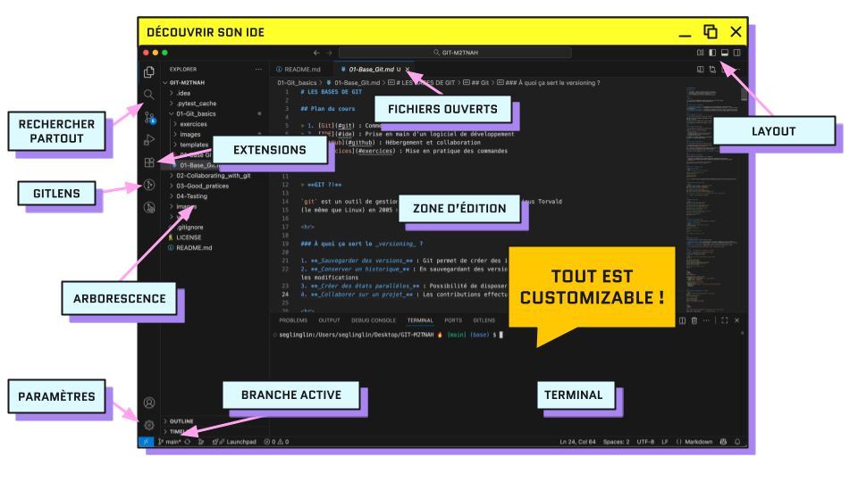

Nous utiliserons [VSCode](https://code.visualstudio.com/) ou [VSCodium](https://vscodium.com/).

**Ouvrir un repository** : `File > Open Folder…` puis sélectionner le dossier contenant le _repository_

**Ouvrir le terminal intégré** : icône de panneau en haut à droite, ou `` Ctrl+` ``

<hr>

[//]: # (### Choisir son IDE)
[//]: # ()
[//]: # (|                    | PyCharm                                                          | VS Code                                                       |)
[//]: # (|--------------------|------------------------------------------------------------------|---------------------------------------------------------------|)
[//]: # (| **Licence**        | Version _community_ gratuite, licence complète avec l’École      | Gratuit et partiellement _open source_ &#40;VSCodium : entièrement&#41; |)
[//]: # (| **Éditeur**        | JetBrains                                                        | Microsoft                                                     |)
[//]: # (| **Philosophie**    | Comprend de base de nombreuses fonctionnalités                   | Modulable à l'infini avec les extensions de la communauté     |)
[//]: # ()
[//]: # (**Obtenir la licence étudiant JetBrains**)
[//]: # ()
[//]: # (1. Créer un compte avec son adresse email de l’École pour avoir accès à toute la suite JetBrains : [jetbrains.com/shop/eform/students]&#40;https://www.jetbrains.com/shop/eform/students&#41;)
[//]: # (2. Télécharger la Toolbox pour une installation facile : [jetbrains.com/toolbox-app]&#40;https://www.jetbrains.com/toolbox-app&#41;)
[//]: # ()
[//]: # (<hr>)

### Source Control

Un espace dédié de VSCode pour git (`Ctrl+Shift+G`) :

- démarrer un projet à partir d’un _repository_
- visualiser l’état des fichiers (c’est un `git status` graphique)
- visualiser l’historique
- résoudre des conflits
- …

Lettres affichées à côté des fichiers :

| Lettre | Signification                                        |
|--------|------------------------------------------------------|
| **U**  | _Untracked_ : nouveau fichier jamais ajouté          |
| **M**  | _Modified_ : fichier suivi, modifié                  |
| **A**  | _Added_ : nouveau fichier ajouté à la _staging area_ |
| **D**  | _Deleted_ : fichier supprimé                         |

Les fichiers apparaissent sous **_Changes_** (pas encore dans la _staging area_) 
ou sous **_Staged Changes_** (dans la _staging area_).

<hr>

#### Extensions
Dans le menu extensions, vous pouvez installer des plugins pour étendre les fonctionnalités de votre IDE.
Par exemple :

- **GitLens** : pour visualiser l’historique des fichiers (recommandé, à installer)
- **Python** : pour le support du langage Python (recommandé, à installer)
- [**Pyright**](https://marketplace.visualstudio.com/items?itemName=ms-pyright.pyright) : pour l’analyse de code en Python
- [**Pylance**](https://marketplace.visualstudio.com/items?itemName=ms-python.vscode-pylance) : pour l’analyse de code en Python (sur VSCode seulement)
- [**Jupyter**](https://marketplace.visualstudio.com/items?itemName=ms-toolsai.jupyter) : fonctionnalités Jupyter
- [**Git History**](https://marketplace.visualstudio.com/items?itemName=donjayamanne.githistory) : fonctionnalités avancées pour Git
- [**Better comments**](https://marketplace.visualstudio.com/items?itemName=aaron-bond.better-comments) : lisibilité des commentaires dans le code

<hr>

#### Raccourcis clavier infiniment utiles

Ouvrir le menu des _Keyboard Shortcuts_ : `Ctrl+K Ctrl+S`

| Défaut                    | Action                                                  | Dénomination                       |
|---------------------------|---------------------------------------------------------|------------------------------------|
| `Ctrl+D`                  | Sélectionner la prochaine occurrence du mot sélectionné | _Add Selection To Next Find Match_ |
| `Shift+Ctrl+K`            | Supprimer la ligne courante                             | _Delete Line_                      |
| `Ctrl+/`<br>`Shift+Alt+A` | Commenter/décommenter la sélection                      | _Toggle block/Line comment_        |

[//]: # (| `Ctrl+Shift+L`         | `Ctrl+Shift+D` | Sélectionner toutes les occurrences du mot sélectionné  | _Select All Occurrences_           |)

<hr>

## Création de son premier commit

### Initialiser un _repository_

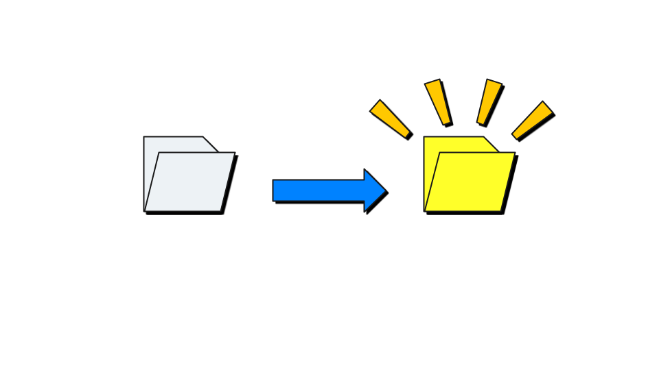

Un dossier normal devient un _repository_ grâce à une commande :

```bash
# Se déplacer dans le dossier où créer le repo
cd <directory-name>

# Initialiser le repository
git init

# Afficher le contenu du dossier
ls -al

# → un dossier .git/ caché a été créé
```

> 🚨️ **Piège fréquent** : lancer `git init` dans son dossier personnel (`~`) transforme **tout** son compte en _repository_.
> Pour annuler : supprimer le dossier `.git/` créé par erreur (`rm -rf ~/.git`).

<hr>

### Processus de commit

La création d’un commit, se fait en plusieurs étapes :

0. **Modification des fichiers** : Ajout/suppression de fichiers, changement du contenu, renommage, etc.
1. **Choix des fichiers** : Sélection des fichiers à inclure dans le commit pour les ajouter à la **_staging area_**
2. **Création de la sauvegarde** : Enregistrement effectif de l’état des fichiers dans le _commit_

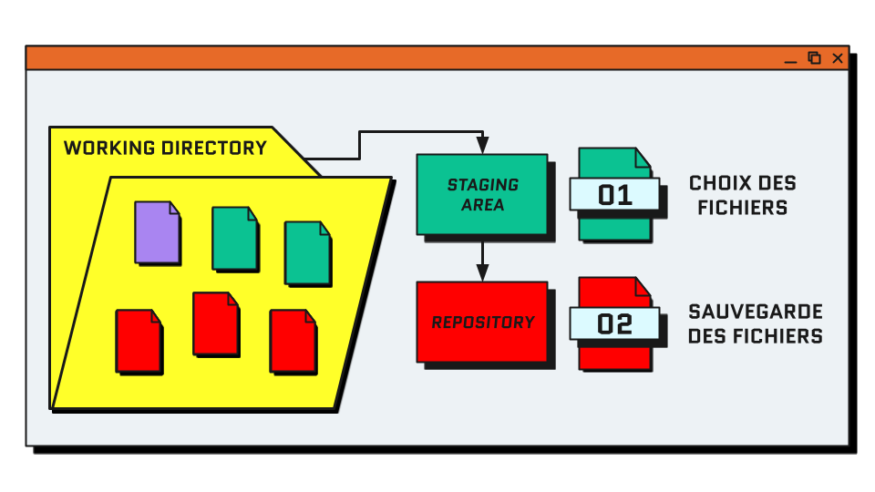 Staging area > Commit">

<hr>

### Connaître l'état du _repository_ : `git status`

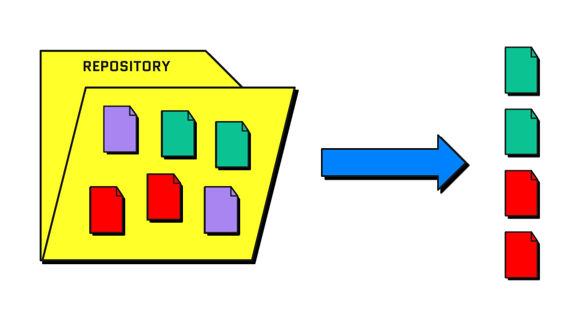

`git status` liste les fichiers modifiés depuis le dernier commit, et indique s’ils sont dans la _staging area_ ou non.

Un fichier peut être dans **trois états** :

| Section de `git status`                    | Signification                                                           | Couleur |
|--------------------------------------------|-------------------------------------------------------------------------|---------|
| _Modifications qui seront validées_        | fichier indexé (« addé »), sera inclus dans le prochain commit          | vert    |
| _Modifications qui ne seront pas validées_ | fichier déjà suivi, modifié depuis le dernier commit, pas encore indexé | rouge   |
| _Fichiers non suivis_                      | nouveau fichier, jamais ajouté à git                                    | rouge   |

Exemple :
```bash
$ git status
Sur la branche main

# FICHIERS QUI ONT ÉTÉ INDEXÉS ("ADDÉS")
Modifications qui seront validées :
  (utilisez "git rm --cached <fichier>..." pour désindexer)
	nouveau fichier : fichier1.txt
	nouveau fichier : fichier2.txt

# FICHIERS NOUVEAUX, JAMAIS INDEXÉS
Fichiers non suivis:
  (utilisez "git add <fichier>..." pour inclure dans ce qui sera validé)
	fichier3.txt
	fichier4.txt
```

<hr>

### Visualiser les modifications : `git diff`

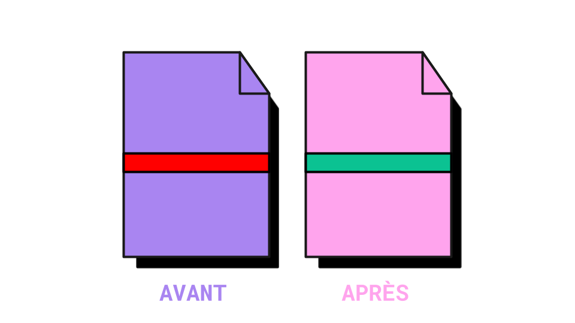

`git status` dit **quels** fichiers ont changé ; `git diff` montre **ce qui** a changé, ligne par ligne.
On utilise `git diff` pour avoir en tête toutes les modifications avant de créer le commit.

```bash
# voir le contenu des modifications depuis le dernier commit
git diff
# dans un fichier particulier
git diff <path/to/file>

# voir les modifications déjà ajoutées à la staging area
git diff --staged

# avec une autre branche
git diff <branch-name>
# entre deux branches
git diff <branch-name> <branch-name>
```

> 💡️ **Deux situations où `git diff` n’affiche rien** :
> 1. le fichier est **nouveau** (non suivi) : git ne le connaît pas encore, il n’a rien à comparer
> 2. le fichier a **déjà été ajouté** à la _staging area_ → utiliser `git diff --staged`

<hr>

Exemple :
```bash
$ git diff

diff --git a/fichier1.txt b/fichier1.txt # Développement des fichiers comparés

index 04af84e..c006980 100644            # hash des versions

--- a/fichier1.txt                       # Fichier avant modification
+++ b/fichier1.txt                       # Fichier après modification

@@ -1 +1 @@                              # Ligne affectée par le changement

-Bonjour, vous allez-bien ?              # Ligne avant modification
+Salut, tu vas bien ?                    # Ligne après modification
```

<hr>

### Ajout à la _staging area_ : `git add`

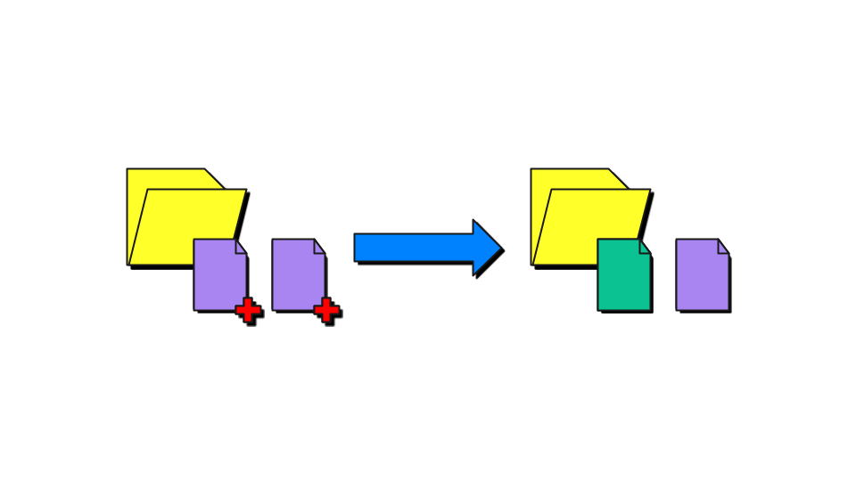

On parle aussi d'indexation de fichiers.

```bash
# lister tous les fichiers modifiés depuis le dernier commit
git status

# ajout d’un fichier précis
git add <path/to/filename>
# ajout de plusieurs fichiers
git add <path/to/filename1> <path/to/filename2>
# ajout de tous les fichiers d’un dossier
git add <path/to/directory>

# ajout de tous les fichiers du dossier courant et de ses sous-dossiers
git add .
# ajout de tous les fichiers du repo
git add -A

# retirer un fichier de la staging area (sans perdre les modifications)
git restore --staged <path/to/filename>
```

> 🗒️ Note: git fonctionne mieux avec des fichiers texte brut, on évite `.docx`, `.odt`, etc.
> Dans VSCode, le `+` à côté d’un fichier dans _Source Control_ équivaut à `git add <fichier>`.

<hr>

### Concevoir un bon commit

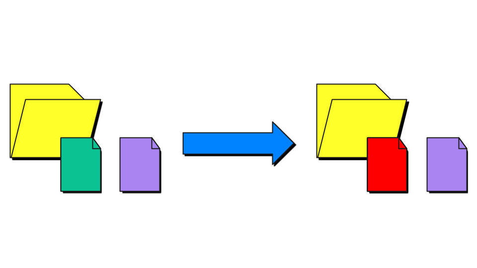

Seuls les fichiers ajoutés (« addés ») sont commités.

```bash
# commit des fichiers de la staging area
git commit

# commit avec message
git commit -m "<commit-message>"
```

<hr>

**🚨 ALERTE : oubli du `-m` après `commit` !**

Lorsqu'on ne précise pas directement le message avec l'argument `-m`, 
git ouvre l'éditeur de texte du terminal pour y écrire le message.

```
ÉCRIRE VOTRE MESSAGE ICI
# Veuillez saisir le message de validation pour vos modifications. Les lignes
# commençant par '#' seront ignorées, et un message vide abandonne la validation.
#
# Sur la branche main
# Votre branche est à jour avec 'origin/main'.
#
# Modifications qui seront validées :
#       modifié :         added_file.txt
#
# Fichiers non suivis:
#       other_file_that_was_not_added.txt
```

1. Sur **nano** (éditeur défini par défaut plus haut)
   1. Écrire le message de commit
   2. Enregistrer avec `Ctrl+S`
   3. Quitter avec `Ctrl+X`
2. Sur **vim** (c'est normal de paniquer la première fois)
   1. Appuyer sur `i` pour passer en mode édition
   2. Écrire le message de commit
   3. Appuyer sur `Esc` pour quitter le mode édition
   4. Taper `:x!` pour enregistrer et quitter ou `:q!` pour quitter sans enregistrer

<hr>

#### Historique des commits : `git log`

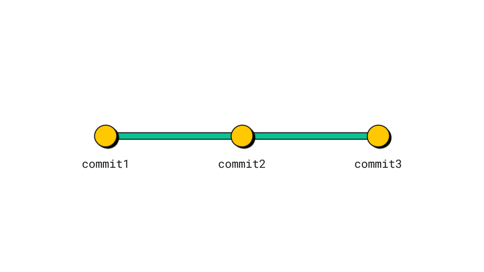

```bash
# affichage de l’historique in extenso
git log

# historique compact (récent en haut)
git log --oneline # glog

# graphe de l’historique de toutes les branches
git log --oneline --graph --all

# quitter avec q
```

<hr>

### Récapitulatif : faire un commit

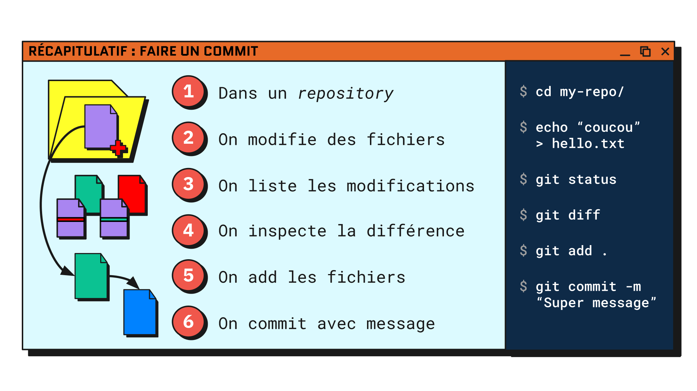

<hr>

### Exercice 2 : Créer son _repository_ de note de lecture

> **Le projet fil rouge 🧶**
>
> Rédaction **en groupe de note de lecture** d’un mémoire écrit par d’ancien·nes étudiant·es du master.
> 1. **Par 2 ou 3**, choisissez un mémoire sur [HAL – École nationale des chartes](https://enc.hal.science/search/index/?q=*&rows=30&docType_s=MEM&sort=publicationDate_tdate+desc)
> 2. **Répartissez-vous les parties** : une personne = une partie
> 3. **Cours 1** : chacun·e travaille **seul·e** sur sa partie
> 4. **Cours 2** : on réunit les parties de chacun·e dans un _repository_ commun

Structure du _repository_ que vous allez construire :

```
note-de-lecture/
├── README.md          # notice du mémoire
├── chapitre-N.md      # votre résumé en 5 points (N = numéro du chapitre)
├── biblio.md          # références bibliographiques du mémoire
└── brouillon.txt      # vos notes personnelles, qui ne seront jamais sauvegardées dans git
```

[//]: # (TODO détailler chaque étape et veiller à la praticabilité)

1. Créer un dossier `note-de-lecture`
2. L’ouvrir dans VSCode
3. Initialiser un _repository_ git
4. Créer les fichiers suivants :
   - `README.md` : la notice du mémoire
     ```md
     # <titre du mémoire>
     
     - Auteur·ice :
     - Titre :
     - Année de soutenance :
     - Lien HAL :
     ```
   - `chapitre-N.md` : autant de fichiers que de chapitres dans votre partie (`chapitre-1.md`, `chapitre-2.md`…)
     ```md
     # Chapitre N : <titre du chapitre>
     1.
     2.
     3.
     4.
     5.
     ```
   - `brouillon.txt` : vos notes personnelles
5. Lister les fichiers modifiés et inspecter les changements
6. Ajouter le README (vide) à la _staging area_ et faire un commit spécifique
7. Ajouter tous les fichiers chapitres (vides) à la _staging area_ et faire un commit spécifique
8. Ne jamais ajouter `brouillon.txt`

✅ **RÉUSSI SI** : `git log --oneline` affiche **2 commits** et `git status` n’affiche plus que `brouillon.txt`

[Correction](./exercices/exercice2.sh)

<hr>

### Réussir ses commits

Pour faire un bon commit :

1. **Le bon contenu** : Ne commiter que les fichiers pertinents, si on a entamé plusieurs chantiers, les commiter un par un
2. **Le bon message** : Chaque commit est documenté avec un message résumant les modifications : il doit être explicite et concis
3. **Le bon moment** : Commiter lorsqu’on a achevé une modification significative. Privilégier les petits commits.

<hr>

#### 1️⃣ Le bon contenu

Si plusieurs chantiers sont en cours, on les commite séparément grâce à la _staging area_.

Ne jamais commiter :
- des fichiers personnels ou de brouillon
- des fichiers générés automatiquement (`__pycache__/`, `.DS_Store`, etc.)
- des mots de passe ou clés d’accès

<hr>

#### 2️⃣ Le bon message

**Le message de commit parfait** (convention [_Conventional Commits_](https://www.conventionalcommits.org/fr/), simplifiée)

> #### `type(scope): description`

L’idée, c'est de pouvoir identifier rapidement l’objet du commit. On choisit le `type` parmi **5 mots-clés** :

| `type`     | Quand l’utiliser ?                            | Exemple                                                 |
|------------|-----------------------------------------------|---------------------------------------------------------|
| `feat`     | j’**ajoute** du contenu ou une fonctionnalité | `feat(chapitre-2): ajout du résumé en 5 points`         |
| `fix`      | je **corrige** une erreur                     | `fix(readme): correction de l’année de soutenance`      |
| `docs`     | je modifie la **documentation** (README)      | `docs(readme): ajout du lien HAL`                       |
| `refactor` | je **réorganise** ou reformule                | `refactor(chapitre-2): reformulation des points 3 et 4` |
| `test`     | j’ajoute ou modifie des **tests** (cours 5)   | `test: vérification du format de students.json`         |

- **`type`** : un des 5 mots-clés, en minuscules
- **`(scope)`** : facultative, le fichier ou la partie du projet concernée
- **`description`** : une seule phrase courte de description

> 💭 Pensez à votre vous du futur : est-ce que je vais encore me comprendre dans 6 mois ?

<hr>

#### 3️⃣ Le bon moment

Comparez ces deux historiques d’une même note de lecture :

```
❌ Historique A        ✅ Historique B
--------------------   ------------------------------------------------------
f3a1c2e final2         f3a1c2e feat(chapitre-2): rédaction du point 5
9b8d7e6 final          9b8d7e6 fix(readme): correction de l’année de soutenance
4c5d6e7 aaa            4c5d6e7 feat(chapitre-2): rédaction des points 3 et 4
1a2b3c4 modifs         1a2b3c4 feat(chapitre-2): rédaction des points 1 et 2
0e9f8a7 wip            0e9f8a7 docs: création de la notice du mémoire
```

> 💡 **Règle** : un commit = une modification que l’on peut résumer en **une phrase**

<hr>

### Le bon message

🗳️ [Quiz : le meilleur message de commit](https://www.menti.com/alobkjosmvr3)
Pour chacun des `git diff` affichés à l’écran, proposer un message de commit

<hr>

### Exercice 3 :  

1. Dans un de vos `chapitre-N.md`, compléter le titre du chapitre et rédiger les 5 points
2. Afficher la liste des fichiers modifiés
3. Inspecter le contenu du fichier modifié
4. Ajouter le fichier à la _staging area_
5. Commiter avec un message au top 💯

✅ **RÉUSSI SI** : `git log --oneline` affiche **3 commits**

[Correction](./exercices/exercice3.sh)

<hr>

## Remonter le temps

### Annuler et retrouver : `git restore` et `git show`

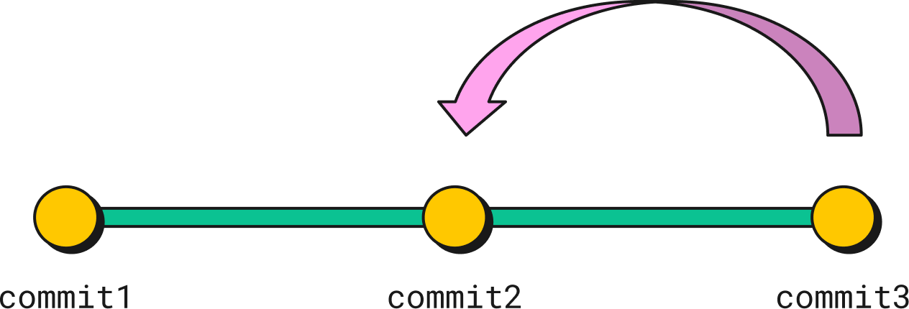

```bash
# annuler les modifications non commitées d’un fichier
git restore <path/to/file>

# retirer un fichier de la staging area (les modifications sont conservées)
git restore --staged <path/to/file>

# afficher le contenu d’un fichier tel qu’il était dans un commit passé
git show <hash>:<path/to/file>

# remettre un fichier dans l’état d’un commit passé
git restore --source=<hash> <path/to/file>
```

<hr>

### Exercice 4 : La machine à remonter le temps

1. Dans le `chapitre-N.md` résumé à l’exercice 3, supprimer les points 1 et 2
2. Afficher la liste des fichiers modifiés et copier le _path_ de la fiche
3. Revenir à la version non-modifiée de la fiche
4. Afficher l’historique et copier le hash de votre premier commit sur `chapitre-N.md`
5. Afficher le contenu de `chapitre-N.md` tel qu’il était dans ce commit

✅ **RÉUSSI SI** : vos points 1 et 2 sont revenus dans VSCode + `git show` affiche la version initiale avec les 5 points vides

[Correction](./exercices/exercice4.sh)

<hr>

## Les branches

### Qu’est-ce qu’une branche ?

Une branche est une **suite de commits** qui avance indépendamment des autres.
On peut la voir comme un état alternatif du _repository_.

Concrètement, une branche n'est qu'un **pointeur** vers un commit, le dernier de cette suite.
À chaque nouveau commit sur la branche, le pointeur change avance sur ce nouveau commit.

Conséquences :
- créer une branche ne copie aucun fichier
- changer de branche remplace le contenu des fichiers du dossier
- les fichiers non suivis (comme `brouillon.txt`) n’appartiennent à aucune branche : ils restent visibles quelle que soit la branche

> 📍 `HEAD` désigne la branche sur laquelle vous vous trouvez : c’est le « Vous êtes ici » du plan.

<hr>

### Création d'une branche : `git switch -c <branch-name>`

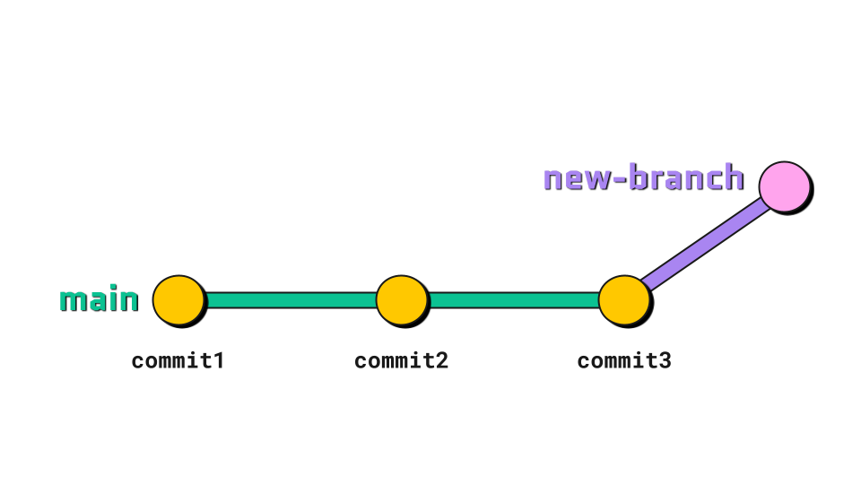

La nouvelle branche prend pour point de départ la branche depuis laquelle on l’a créée.
Il faut donc au moins un commit dans le _repository_ avant de créer une branche.
⚠️ Avant de changer de branche, on commite !

```bash
# affiche les branches existantes (* = branche courante)
git branch
# crée une branche nommée <branch-name>
git branch <branch-name>
# change la branche courante
git switch <branch-name>

# crée + change de branche
git switch -c <branch-name>

# ancienne façon de faire
git checkout -b <branch-name>
```

> 💡 Dans VSCode, la branche courante s’affiche en bas à gauche ; un clic dessus permet d’en changer.

<hr>

## La fusion de branches

Il existe deux façons de fusionner des branches :

| Merge                                                     | Rebase                                                                     |
|-----------------------------------------------------------|----------------------------------------------------------------------------|
| Fusion sans réécriture de l’historique                    | Réécriture de l'historique : commits déplacés sur une autre branche (base) |
| Résolution des conflits en une seule fois                 | Résolution des conflits commit après commit                                |
| Génère un commit de merge qui rassemble les modifications | Historique linéaire sans commit de merge                                   |

<hr>

#### Fusion avec `git merge <branch-name>`

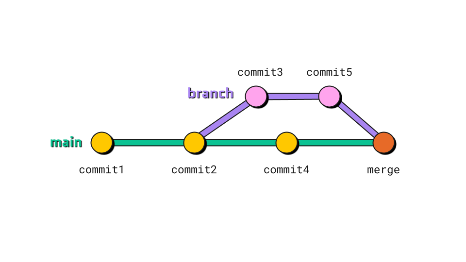

Merge crée un nouveau commit de fusion qui combine deux branches.
Ce commit possède deux parents et préserve l'historique complet des deux branches.
Tous les conflits éventuels sont résolus une seule fois dans ce commit de merge.

```bash
# merge de main dans my-branch
[my-branch] git merge main
```

> 🗒️ Lorsque git crée un commit de merge, il ouvre l’éditeur (nano) avec un message automatique 
> (`Merge branch '...' into '...'`) : il suffit d’enregistrer et de quitter

**Le _fast-forward_.**
Si la branche courante **n’a reçu aucun nouveau commit** depuis la création de l’autre branche, 
il n’y a rien à combiner : git se contente de faire pointer la branche courante sur le dernier commit de la branche à merger.
L'historique reste linéaire.

<hr>

#### Réécriture avec `git rebase <branch-name>`

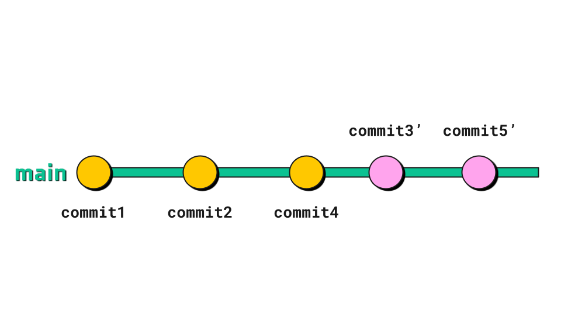

Rebase réécrit l'historique en déplaçant les commits de la branche courante sur autre branche (nouvelle base).
Chaque commit est recréé un par un, comme si les modifications avaient été faites directement après les derniers commits de la branche base.
Les conflits éventuels sont résolus séparément pour chaque commit recréé.

```bash
# rebase de main dans my-branch
[my-branch] git rebase main

# main = branche de base / my-branch = branche rebasée
# les commits de my-branch sont réécrits sur main
```

<hr>

#### ⚠️ À retenir lors de la fusion : la règle du merge en 2️⃣ temps

> **Avant de fusionner, on met à jour**

1. **D'abord** : on récupère les dernières modifs
    ```bash
    # Depuis MA branche, je récupère les changements de main
    /my/repo [my-branch] git merge main
    # ou
    /my/repo [my-branch] git rebase main
    ```
    → Ma branche est maintenant à jour avec main
2. **Ensuite** : on partage ses modifications
    ```bash
    # Je switch sur main
    /my/repo [my-branch] git switch main
    # Je fusionne ma branche
    /my/repo [main] git merge my-branch
    ```
    → `main` contient maintenant mes modifications

🚨️ On ne **rebase JAMAIS** depuis une branche où on travaille à plusieurs.
🛟 De manière générale, préférer `merge` pour s'épargner des sueurs froides.

> ### 💡 _Synchroniser avant de merger_

[//]: # (> **Pourquoi fusionner main dans sa branche AVANT de merger ?**)
[//]: # (> _Scénario : d'autres commits ont été `main` pendant que tu travaillais sur ta branche_)
[//]: # (> )
[//]: # (> Merge directement dans `main` :)
[//]: # (> - Les conflits apparaissent sur `main` &#40;branche partagée&#41;)
[//]: # (> - Ton code n'a jamais été testé avec les dernières modifications de `main`)
[//]: # (> - Si ça casse, c'est `main` qui est cassée &#40;impact sur toute l'équipe&#41;)
[//]: # (> )
[//]: # (> Fusionner `main` dans ta branche d'abord :)
[//]: # (> - Les conflits apparaissent sur ta branche)
[//]: # (> - Tu les résous tranquillement)
[//]: # (> - Tu testes que tout fonctionne encore, personne d'autre n'est impacté)
[//]: # (> )
[//]: # (> Quand tu merges dans `main`, les conflits sont déjà résolus ! )
[//]: # (> &#40;en particulier utile pour les _pull requests_ que nous verrons plus tard&#41;)

<hr>

#### Exercice 5 : Effectuer un merge sur VSCode

```md
1. Dans son _repository_ `note-de-lecture` ouvert sur VSCode
2. Créer une branche `biblio` et s’y déplacer
3. Créer `biblio.md` et y ajouter une référence citée dans le mémoire
4. Depuis le terminal intégré, ajouter et commiter le fichier
5. Revenir sur `main` et observer l'arborescence de fichiers
6. Sur `main`, remplir les informations sur le mémoire dans le `README.md` et commiter
7. Afficher le graphe : `git log --oneline --graph --all`
8. Revenir sur `biblio` et fusionner main
9. Depuis main, merger biblio
```

✅ **RÉUSSI SI** : `git log --oneline --graph --all` montre la fourche puis la réunion.

[Correction](./exercices/exercice5.sh)

<hr>

## Les conflits

Lorsque les deux branches à fusionner comportent des modifications sur les mêmes lignes de code, 
il est nécessaire de choisir manuellement quelle modification doit être conservée.

```bash
# Création d’un fichier et commit
[main] echo "Hello world!" > hello.txt
[main] git add hello.txt
[main] git commit -m "Hello file creation"

# Modification du fichier dans une branche
[main] git switch -c branch
[branch] echo "Hello from branch!" > hello.txt
[branch] git commit -am "Hello file modif"

# Modification du fichier dans une autre branche
[branch] git switch main
[main] echo "Hello from main!" > hello.txt
[main] git commit -am "Hello file update"

[main] git merge branch # CONFLIT ⛔️ 
```

> 🗒️ `git commit -am` = `git add` + `git commit -m`, mais **uniquement pour les fichiers déjà suivis**.

<hr>

#### Résolution manuelle de conflits

1. Trouver les zones de code conflictuelles : recherche `<<<<<<<` dans la _codebase_
   ```python
   # HEAD correspond à la branche où vous êtes
   def hello():
   <<<<<<< HEAD
       print("Hello from my-branch!")
   =======
       print("Hello from other-branch!")
   >>>>>>> other-branch
   ```
2. Choisir quelle version conserver (ou faire un mix des deux)
   ```python
   # Résoudre un conflit revient à ne laisser qu’une version
   def hello():
       print("Hello from my-branch and other-branch!")
   ```
3. Finaliser le merge
   ```bash
   # Ajouter les fichiers modifiés à la staging area
   git add <path/to/file>
   # Finaliser le merge avec un commit, git génère automatiquement le message
   git commit
   # Ctrl+S pour enregistrer, Ctrl+X pour quitter
   ```

> 🛟 Paniqué·e au milieu d’un conflit ? `git merge --abort` annule le merge et revient à l’état d’avant.

<hr>

#### Résolution de conflits avec le _Merge Editor_

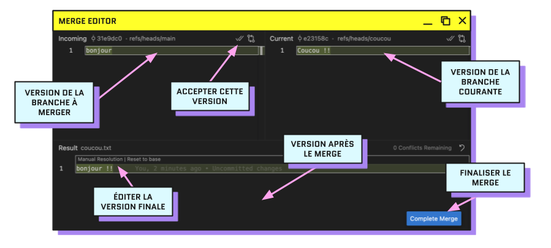

1. Ouvrir _**Source Control**_ (`Ctrl+Shift+G`)
2. Pour chaque fichier en conflit sous "_Merge Changes_" :
   - Résoudre les conflits
   - Cliquer sur "_Complete Merge_" (`add` le fichier à la _staging area_)
3. Finaliser le merge avec "Continue" (`commit` avec le message généré par Git)

| Zone du _Merge Editor_             | Contenu                                    |
|------------------------------------|--------------------------------------------|
| _Incoming_ (gauche)                | version de la branche à merger             |
| _Current_ (droite)                 | version de la branche courante             |
| _Result_ (bas)                     | version après le merge, éditable à la main |
| _Accept Incoming / Accept Current_ | accepter l’une des versions en un clic     |
| _Complete Merge_                   | marquer le fichier comme résolu            |

<hr>

#### Exercice 6 : Provoquer et résoudre un conflit

```md
1. Depuis `main`, créer une branche `titre-a`, y modifier le titre du `README.md` et commiter
2. Revenir sur `main`, créer une branche `titre-b`, y modifier LA MÊME ligne autrement et commiter
3. Revenir sur `main` et merger `titre-a` (fast-forward)
4. Toujours sur `main`, merger `titre-b` (conflit)
5. Résoudre le conflit dans le Merge Editor en combinant les deux propositions
6. Finaliser le merge
7. Afficher le graphe : `git log --oneline --graph --all`
```

✅ **RÉUSSI SI** : `README.md` ne contient plus aucun marqueur `<<<<<<<` / `=======` / `>>>>>>>`

[Correction](./exercices/exercice6.sh)

<hr>

### Interro surprise ! 😱

🗳️ [Quiz : la bonne commande](https://www.menti.com/alehkfzvthiu)

<hr>

## Ce que vous savez faire maintenant

1. ✅ Transformer un dossier en _repository_ Git
2. ✅ Savoir à tout moment où vous en êtes dans vos modifications
3. ✅ Choisir quoi sauvegarder et l’enregistrer avec un message utile
4. ✅ Retrouver et restaurer une version passée d’un fichier
5. ✅ Travailler sur une variante sans toucher à la version principale
6. ✅ Réunir deux variantes et résoudre un conflit
