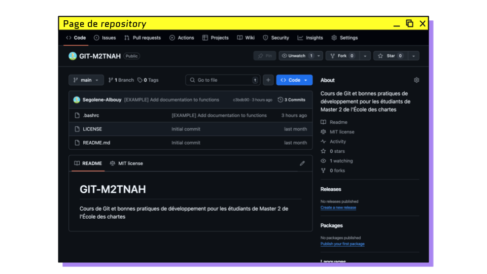
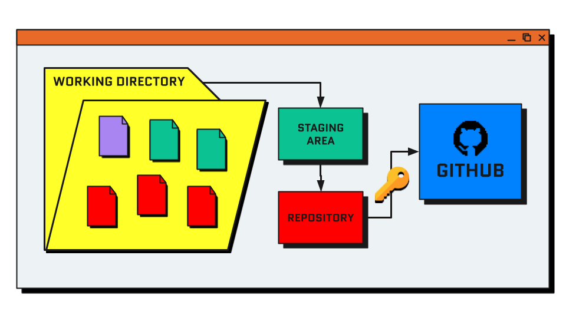
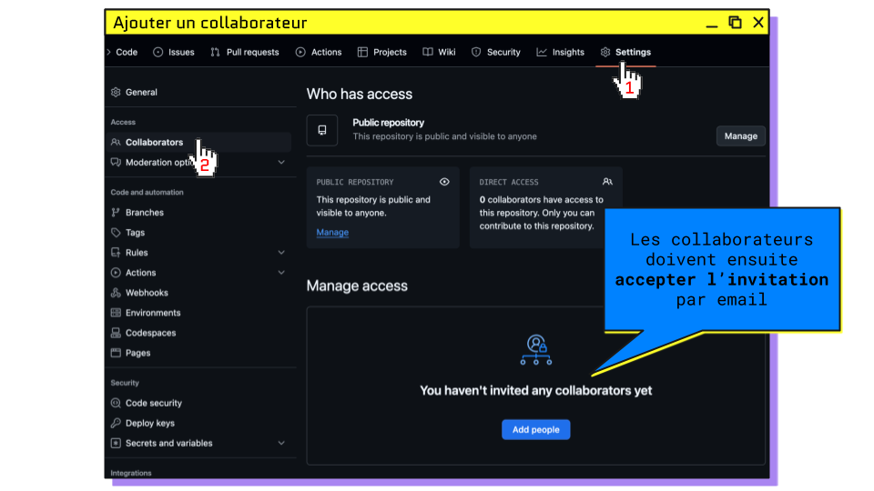
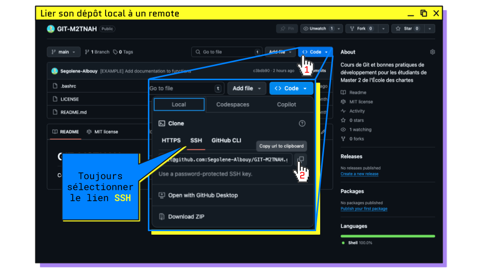
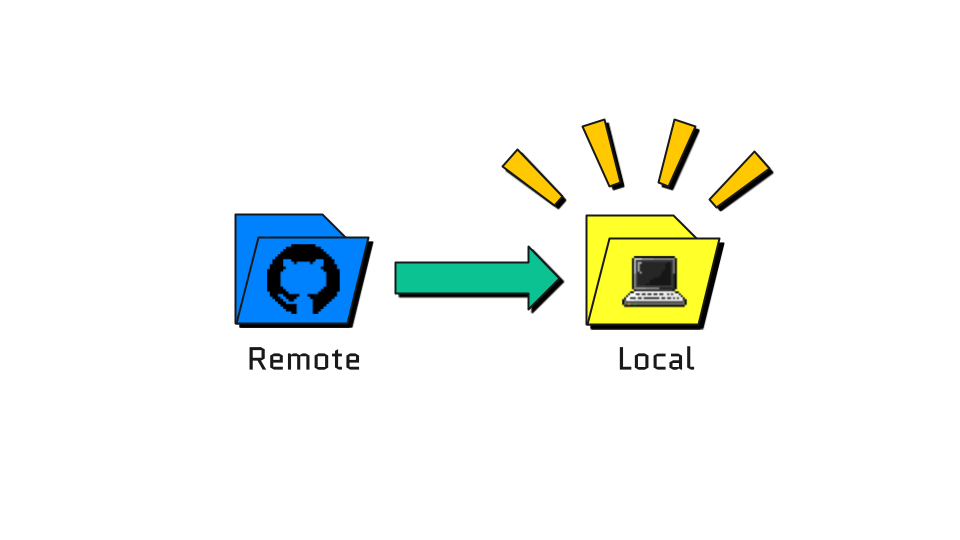
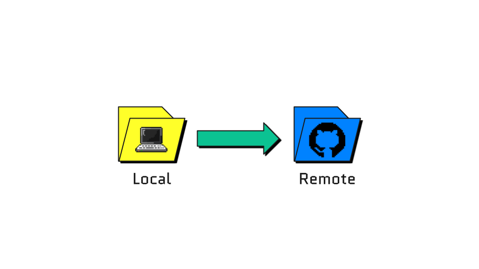
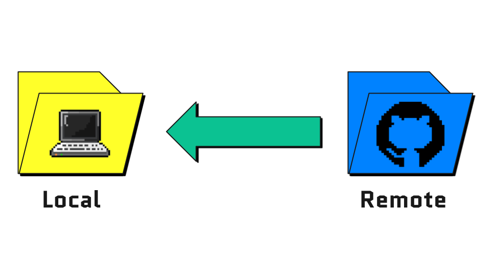
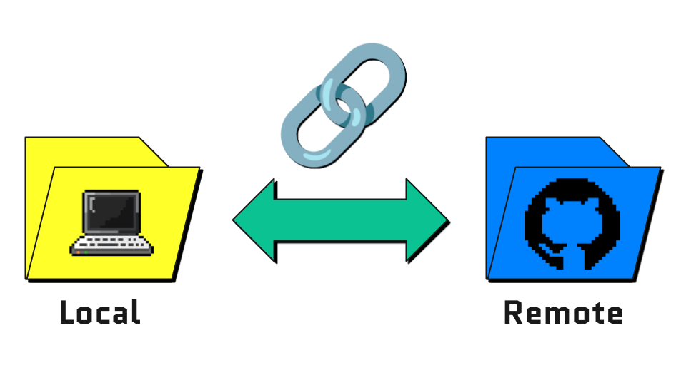

# GITHUB

## Plan du cours

### [▶️ Slides du cours](https://docs.google.com/presentation/d/e/2PACX-1vRFw1aa1ndHBuDF8A04KrDjOHGKs48CgEi_of2fhC1mm0rr1HErno39ymKD8XdUO0lAoZblIzhUSxlL/pub?start=false&loop=false&delayms=3000)

> 1. [GitHub](#github) : pourquoi héberger son code en ligne
> 2. [Échauffement](#échauffement--ignorer-des-fichiers) : `.gitignore`
> 3. [Local et remote](#repository-local-et-remote) : deux copies d’un même _repository_
> 4. [Authentification](#authentifier-son-ordinateur-auprès-de-github) : la clé SSH
> 5. [Créer et partager](#créer-et-partager-un-repository) : collaborateurs, `clone`
> 6. [Synchroniser](#synchroniser-son-repository) : `push`, `pull`, `fetch`
> 7. [Les branches distantes](#les-branches-distantes) : `push -u`, `switch`
> 8. [Récapitulatif](#ce-que-vous-savez-faire-maintenant)
> 9. [Annexes](#annexes) : licence étudiante, publier un _repository_ créé en local

<hr>

## GitHub

> **Question** : VSCode, l’éditeur que vous utilisez, est développé par des milliers de personnes.
> Comment travaillent-elles sur le même code sans s’emmêler les pinceaux ?
>
> 👉 [github.com/microsoft/vscode](https://github.com/microsoft/vscode) : regardez le nombre de _commits_ et de contributeurs.

Réponse : chacun travaille sur sa copie du _repository_ avec git, 
et une copie de référence est hébergée en ligne, accessible à tous.

**GitHub est un service en ligne pour héberger ses _repositories_.**

Il en existe d’autres :

- [GitHub](https://github.com) : option la plus répandue, sert de portfolio aux développeurs
- [GitLab](https://gitlab.com/) : très utilisé en entreprise, peut être hébergé sur des serveurs privés
- [Bitbucket](https://bitbucket.org) : version développée par Atlassian

<hr>

### Git vs GitHub

| Git                                                       | GitHub                                                    |
|-----------------------------------------------------------|-----------------------------------------------------------|
| Gestionnaire de versions                                  | Service d’hébergement en ligne                            |
| Outil local sur sa machine pour modifier ses repositories | Là où stocker et publier ses repositories                 |
| Ensemble de commandes disponibles dans le terminal        | Interface web pour visualiser et collaborer sur des repos |

> 💡 Git fonctionne sans internet et sans GitHub. GitHub n’est utile que pour **partager** un _repository_.

<hr>

## Échauffement : ignorer des fichiers

Au cours 1, `brouillon.txt` ne devait jamais être ajouté à git. 
Problème : il apparaît à chaque `git status`, et un `git add .` distrait suffirait à l’ajouter… puis à le publier en ligne.

### Fichiers spéciaux du _repository_

- [`.gitignore`](./templates/.gitignore) : liste des fichiers à ignorer par git
- [`README.md`](./templates/README.md) : documentation du projet, s’affiche sur la page principale du _repository_
- [`LICENSE`](http://choosealicense.com) : licence précisant les conditions d’utilisation du code

<hr>

### Ignorer des fichiers : `.gitignore`

Le fichier [`.gitignore`](./templates/.gitignore) se place à la racine du _repository_. 
Chaque ligne désigne un fichier, un dossier ou un motif que git doit ignorer :

```gitignore
# Notes personnelles
brouillon.txt

# Fichiers générés automatiquement
__pycache__/
.DS_Store

# Jupyter Notebook
.ipynb_checkpoints

# Environment variables
.env

# Virtual environments
env/
venv/
```

> 💡 Dans VSCode, les fichiers ignorés apparaissent **grisés** dans l’explorateur.
>
> ⚠️ `.gitignore` n’agit que sur les fichiers **non suivis**. 
> Pour ignorer un fichier déjà commité, il faut d’abord le retirer de git (sans le supprimer du disque) : `git rm --cached <path/to/file>`

<hr>

### Exercice 7 : Ignorer son brouillon

1. Ouvrir son _repository_ `note-de-lecture` dans VSCode
2. Afficher la liste des fichiers modifiés : `brouillon.txt` apparaît dans les fichiers non suivis
3. Créer un fichier `.gitignore` à la racine du _repository_, contenant la ligne `brouillon.txt`
4. Afficher à nouveau la liste des fichiers modifiés : qu’est-ce qui a changé ?
5. Ajouter `.gitignore` à la _staging area_ et commiter avec un message au top 💯

✅ **RÉUSSI SI** : `git status` affiche `rien à valider, la copie de travail est propre` et `brouillon.txt` est grisé dans VSCode

[Correction](./exercices/exercice7.sh)

<hr>

## _Repository_ local et remote

| Local                                                  | Remote                                                  |
|--------------------------------------------------------|---------------------------------------------------------|
|   |  |
| Dossier contenant le _repo_ situé sur votre ordinateur | Version en ligne du _repo_, à la manière d’un _drive_   |

Le _remote repository_ est une version en ligne du _repository_ 
qui permet de centraliser l’historique et les modifications. 
Public ou privé, plusieurs collaborateurs peuvent y contribuer, avec différents droits.

Dans git, le _remote_ porte par défaut le nom **`origin`**.

<hr>

### _Repository_ sur GitHub



- **Code** : les fichiers du _repository_ ; en face de chaque fichier s’affiche **le message du dernier commit** qui l’a modifié
- **README** : affiché sous la liste des fichiers
- **Commits** : l’historique complet, comme `git log`
- **Settings** : collaborateurs, visibilité (public/privé) et, tout en bas, la _Danger Zone_ (suppression du _repository_)

<hr>

## Authentifier son ordinateur auprès de GitHub

### Processus de publication



On commence par `add` puis `commit`. 
Pour la dernière étape, GitHub doit être certain que c’est bien **vous** qui envoyez du code sur votre compte : 
votre ordinateur doit s’authentifier.

<hr>

### La clé SSH : un cadenas et sa clé

L’authentification SSH repose sur une **paire de clés** générée sur votre ordinateur :

| Clé publique                                   | Clé privée                                            |
|------------------------------------------------|-------------------------------------------------------|
| 🔒 le **cadenas**                              | 🔑 la **clé** qui l’ouvre                             |
| déposée sur GitHub                             | reste sur votre ordinateur                            |
| peut être partagée sans risque                 | ne se partage **jamais**                              |
| fichier `~/.ssh/id_ed25519.pub`                | fichier `~/.ssh/id_ed25519`                           |

À chaque envoi de code, GitHub vérifie que votre ordinateur possède la clé qui ouvre le cadenas déposé sur votre compte.

> 💡 Une paire de clés **par ordinateur** : si vous changez de machine, vous créez une nouvelle paire.

<hr>

### Créer et enregistrer sa clé SSH

1. Créer une clé SSH depuis le terminal
   ```bash
   # création de la paire de clés
   ssh-keygen -t ed25519
   # ℹ️ appuyer sur Enter pour les options par défaut
   # ⚠️ si le terminal demande "Overwrite (y/n)?", une clé existe déjà : répondre n et la réutiliser
   ...
   Your public key has been saved in <path>
   ...
   
   # afficher le contenu de la clé publique
   cat ~/.ssh/id_ed25519.pub
   # copier toute la ligne qui s’affiche, y compris "ssh-ed25519 ..."
   ```
2. GitHub > Settings > SSH and GPG keys > [New SSH key](https://github.com/settings/ssh/new)
3. Coller la clé publique affichée dans votre terminal 
4. Nommer la clé pour désigner votre ordinateur (ex. `ordi-perso`)

<hr>

### Vérifier la connexion

```bash
ssh -T git@github.com
```

1. **Lors de la première connexion**, le terminal demande :
   ```
   Are you sure you want to continue connecting (yes/no/[fingerprint])?
   ```
   → taper **`yes`** en toutes lettres
2. **Si tout fonctionne** :
   ```
   Hi <github-user>! You've successfully authenticated, but GitHub does not provide shell access.
   ```

> 🧑‍💻 `user.name` / `user.email` **signent** vos commits : ils permettent à GitHub d’associer vos commits à un utilisateur
> 🔑 la clé SSH **authentifie** votre ordinateur : elle autorise l’envoi de code

<hr>

### Exercice 8 : Créer sa clé SSH

1. Créer une paire de clés SSH
2. Afficher la clé publique et la copier
3. L’ajouter sur GitHub en la nommant d’après votre ordinateur
4. Vérifier la connexion

✅ **RÉUSSI SI** : `ssh -T git@github.com` affiche `Hi <github-user>!`

[Correction](./exercices/exercice8.sh)

<hr>

## Créer et partager un _repository_

### Créer un _remote repository_ sur GitHub

Créer un nouveau _repository_ : [github.com/new](https://github.com/new)

- **Repository name** : court, en minuscules, avec des tirets (ex. `note-de-lecture-groupe`)
- **Public / Private** : visible par tous ou seulement par les collaborateurs
- **Add a README file** : ✅ à cocher
- **Add .gitignore** / **Choose a license** : facultatifs, modifiables plus tard

> 💡 En pratique, on crée son _repo_ sur GitHub, puis on le **clone** en local.

<hr>

#### README

Le [`README.md`](./templates/README.md) présente le projet : à quoi il sert, comment l’installer, comment l’utiliser. 
GitHub l’affiche sur la page principale du _repository_.

````md
# Installation

Step-by-step instructions on how to install the project and its dependencies.

1. Clone the repository:
   ```bash
   git clone git@github.com:<username>/<repository>.git
   cd <repository>
   ```
2. Set up environment:
   ...
````

#### LICENSE

La licence précise ce que les autres ont le droit de faire avec votre code. 
Elle se choisit à la création du _repository_ ; [choosealicense.com](https://choosealicense.com) aide à choisir.

<hr>

### Ajouter un collaborateur à son _repository_



1. GitHub > Settings > Collaborators > Add people
2. Les collaborateurs doivent ensuite **accepter l’invitation** reçue par email

Sans invitation acceptée, un collaborateur peut cloner un _repository_ public, mais pas y publier.

<hr>

### Récupérer le lien du _repository_



Bouton **Code** > onglet **SSH** > copier le lien.

GitHub propose deux types de liens :

|                      | SSH                                                     | HTTPS                                               |
|----------------------|---------------------------------------------------------|-----------------------------------------------------|
| **Lien**             | `git@github.com:<user>/<repo>.git`                      | `https://github.com/<user>/<repo>.git`              |
| **Authentification** | clé SSH, configurée une fois par ordinateur             | _token_ ou connexion GitHub de VSCode               |
| **Avantages**        | rien à saisir une fois la clé en place                  | proposé par défaut, fonctionne sur tous les réseaux |
| **Limites**          | certains réseaux (entreprise, wifi public) bloquent SSH | _token_ à créer et à renouveler                     |

> Dans ce cours, on utilise **SSH**. HTTPS reste une option valable, notamment si SSH est bloqué.

<hr>

### Copier un _remote repository_ en local : `git clone <url>`



```bash
# Se déplacer à l’endroit où créer le dossier
cd ~/Documents

# Copier un repo distant sur son ordinateur
git clone <url-repo-distant>

# Par exemple, cloner le repository du cours
git clone git@github.com:Segolene-Albouy/GIT-M2TNAH.git
```

`git clone` crée un dossier du nom du _repository_, contenant les fichiers et **tout l’historique**. 
Le _remote_ `origin` est configuré automatiquement.

> 🚨 **Attention** à ne pas cloner dans un autre _repository_

<hr>

### Cloner directement depuis VSCode

1. Ouvrir la Command palette `Ctrl+Shift+P`
2. Rechercher “Git: Clone”
3. Coller le lien SSH du _repository_
4. Choisir l’emplacement (⚠️ hors d’un autre _repository_)
5. Ouvrir le _repository_ cloné

> 🗒️ VSCode propose aussi “Clone from GitHub” : il utilise alors le lien HTTPS et votre connexion GitHub dans VSCode.

<hr>

### 😭 GitHub veut pas m’autoriser à cloner le _repo_ !

On commence par lire le message de son terminal :

```bash
git@github.com: Permission denied (publickey).
fatal: Could not read from remote repository.

Please make sure you have the correct access rights and the repository exists
```

**`Permission denied (publickey)`** : GitHub ne reconnaît pas votre ordinateur. 
La clé SSH est absente, mal copiée ou a été créée sur un autre ordinateur.

```bash
# Vérifier la connexion SSH avec GitHub
ssh -T git@github.com

# Afficher le contenu de la clé publique (en recréer une avec `ssh-keygen -t ed25519` si besoin)
cat ~/.ssh/id_ed25519.pub

# Copier la clé publique et la coller sur GitHub
```

**`ERROR: Repository not found.`** : GitHub vous reconnaît, mais ne trouve pas le _repository_ ou ne vous y donne pas accès.
- vérifier l’URL (faute de frappe, mauvais nom d’utilisateur)
- pour un _repository_ privé : vérifier que l’invitation de collaborateur a bien été acceptée

<hr>

## Synchroniser son _repository_

### Publier ses commits : `git push`



```bash
# envoyer ses commits locaux sur GitHub
git push
```

Seuls les **commits** sont publiés : les modifications non commitées restent sur votre ordinateur.

<hr>

### Récupérer les commits des autres : `git pull`



```bash
# récupérer les commits publiés sur GitHub et les fusionner avec sa branche
git pull
```

`git pull` réunit deux commandes :
1. `git fetch` : télécharge les nouveaux commits de GitHub, **sans toucher à vos fichiers**
2. `git merge` : fusionne ces commits avec votre branche (cours 1)

<hr>

### Ma branche et la « photo » de GitHub : `origin/main`

Votre _repository_ local contient **deux** versions de `main` :

```
         VOTRE ORDINATEUR                                GITHUB
┌───────────────────────────────────────┐   push   ┌──────────────┐
│ main         ← vos commits            │ ───────► │              │
│                                       │          │     main     │
│ origin/main  ← « photo » de GitHub    │ ◄─────── │              │
│                prise au dernier fetch │  fetch   │              │
└───────────────────────────────────────┘          └──────────────┘
```

- `main` : votre branche, celle sur laquelle vous commitez
- `origin/main` : l’état de `main` sur GitHub **tel que git l’a vu la dernière fois** (au dernier `fetch`, `pull` ou `push`)

C’est en comparant les deux que `git status` vous situe :

| Message de `git status`                                      | Signification                                                   | Action                     |
|--------------------------------------------------------------|-----------------------------------------------------------------|----------------------------|
| `Votre branche est à jour avec 'origin/main'.`               | rien à envoyer, rien à récupérer (depuis la dernière « photo ») | –                          |
| `Votre branche est en avance sur 'origin/main' de 1 commit.` | vos commits ne sont pas encore sur GitHub                       | `git push`                 |
| `Votre branche est en retard sur 'origin/main' de 2 commits` | GitHub a des commits que vous n’avez pas                        | `git pull`                 |
| `Votre branche et 'origin/main' ont divergé`                 | chacun a des commits que l’autre n’a pas                        | `git pull` puis `git push` |

> ⚠️ « À jour » ne veut dire « à jour » que depuis la dernière photo : un collaborateur a pu publier entre-temps. 
> `git fetch` reprend la photo sans modifier vos fichiers.

<hr>

### Synchroniser depuis VSCode

- **Barre d’état** (en bas à gauche, à côté du nom de la branche) : `↓2 ↑1` = 2 commits à récupérer, 1 commit à publier
- **Source Control** > bouton **_Sync Changes_** : effectue un `pull` puis un `push`
- **Source Control** > graphe : `origin/main` y apparaît comme une étiquette sur le commit correspondant

<hr>

### Une même branche, plusieurs copies

Chaque collaborateur possède sa propre copie de chaque branche : 
votre `main`, le `main` de GitHub et le `main` de votre camarade sont **trois branches distinctes**, 
que `push` et `pull` permettent de synchroniser.

> **Règle d’or** : `commit` → `pull` → `push`

<hr>

### Exercice 9 : Réunir sa note de lecture (par groupe)

1. Une personne crée sur GitHub le _repository_ `note-de-lecture-groupe` en cochant **Add a README file**
2. Elle ajoute les autres membres du groupe comme collaborateurs
3. Les autres acceptent l’invitation reçue par email
4. Chacun·e clone `note-de-lecture-groupe` avec le lien SSH
5. Chacun·e ouvre le dossier cloné dans VSCode
6. Copier ses fichiers `chapitre-N.md` depuis `note-de-lecture/` vers `note-de-lecture-groupe/`
7. Ajouter les fichiers et commiter avec un message au top 💯
8. Publier ses commits sur GitHub

> _Que se passe-t-il ? Pourquoi ?_

Lire attentivement le message du terminal, puis faire ce qu’il faut pour publier

✅ **RÉUSSI SI** : la page GitHub du _repository_ affiche les chapitres de tout le groupe

[Correction](./exercices/exercice9.sh)

<hr>

### 😭 L’autre a réussi à _pusher_ mais moi ça marche paaaas !

On commence par lire le message de son terminal :

```bash
To github.com:utilisateur/nom-du-repo.git
 ! [rejected] main -> main (fetch first)
error: failed to push some refs to 'github.com:utilisateur/nom-du-repo.git'
...
hint: (e.g., 'git pull ...') before pushing again.
```

**Pourquoi ?** Un merge est un _fast-forward_ quand la branche n’a qu’à avancer, sans rien combiner.
**GitHub n’accepte un `push` que s’il est un _fast-forward_** : vos commits doivent prolonger exactement le `main` de GitHub.
Si quelqu’un a publié entre-temps, vos commits ne le prolongent plus : GitHub refuse, pour ne pas écraser son travail.

**Solution** : intégrer d’abord les commits publiés, puis publier.

```bash
git pull
git push
```

> 🗒️ Variante du même problème : `! [rejected] main -> main (non-fast-forward)`
> (vous avez déjà récupéré les commits avec `fetch`, mais pas encore fusionné). Même solution.
>
> Si le `pull` provoque un conflit, on le résout avec le _Merge Editor_

<hr>

### 😭 GitHub veut pas m’autoriser à _pusher_ !

On commence par lire le message de son terminal :

```bash
remote: Support for password authentication was removed on August 13, 2021. Please use a personal access token instead.

fatal: Authentication failed for 'https://github.com/username/repo.git/'
```

Le _repository_ a été cloné avec le lien **HTTPS**, et git demande un mot de passe : 
GitHub ne l’accepte plus depuis 2021. Deux solutions :

1. **Passer au lien SSH** (recommandé dans ce cours)
   ```bash
   # Vérifier l’URL actuelle du remote
   git remote -v
   
   # La remplacer par le lien SSH du repository
   git remote set-url origin git@github.com:<user>/<repo>.git
   ```
2. **Rester en HTTPS** avec un [_personal access token_](https://github.com/settings/tokens) saisi à la place du mot de passe, 
   ou en vous connectant à GitHub dans VSCode

<hr>

## Les branches distantes

### Publier une nouvelle branche : `git push -u origin <branch-name>`

Une branche créée en local n’existe pas sur GitHub : il faut indiquer à git sur quelle branche distante la publier.

```bash
$ git push

fatal : La branche courante <branch> n'a pas de branche amont.

Pour pousser la branche courante et définir la distante comme amont, utilisez

    git push --set-upstream origin <branch>
    
$ git push -u origin <branch>
```

`-u` (abréviation de `--set-upstream`) relie la branche locale à la branche distante

> 💡 Dans VSCode, le bouton **_Publish Branch_** de Source Control fait la même chose.

<hr>

### Récupérer la branche d’un·e collaborateur·ice

```bash
# Télécharger les nouvelles branches publiées sur GitHub
git fetch

# Lister toutes les branches, y compris les distantes (remotes/origin/...)
git branch -a

# Se placer sur la branche : git crée automatiquement la branche locale à partir de origin/<branch-name>
git switch <branch-name>
```

<hr>

### Rappel : la règle du merge en 2 temps

> **Avant de fusionner, on met à jour**

```bash
# 0. Récupérer la dernière version de main
[main] git pull

# 1. Mettre sa branche à jour avec main : les conflits éventuels apparaissent sur SA branche
[main] git switch my-branch
[my-branch] git merge main

# 2. Fusionner sa branche dans main, puis publier
[my-branch] git switch main
[main] git merge my-branch
[main] git push
```

<hr>

### Exercice 10 : Chacun·e sa notice, puis fusion (par groupe)

**Partie 1 : travailler en parallèle**

1. Sur `main`, récupérer la dernière version du _repository_
2. Créer une branche `notice-<prénom>` et s’y déplacer
3. Dans `README.md`, remplacer la **première ligne** (le titre) par votre proposition de titre, 
   et ajouter juste en dessous la ligne `Résumé : <le mémoire en une phrase>`
4. Ajouter et commiter
5. Publier sa branche sur GitHub

> _Que se passe-t-il ? Pourquoi n’y a-t-il pas de conflit alors que vous avez modifié les mêmes lignes ?_

**Partie 2 : relire et fusionner**

6. Récupérer la branche d’un·e camarade, s’y déplacer et lire sa notice, puis revenir sur sa branche
7. **Personne A** : fusionner sa branche dans `main` et publier `main`
8. **Personne B** (puis la personne C pour un groupe de 3) :
   1. Récupérer la dernière version de `main`
   2. Revenir sur sa branche et y fusionner `main` : **conflit**
   3. Résoudre le conflit dans le _Merge Editor_ en combinant les propositions
   4. Finaliser le merge
   5. Fusionner sa branche dans `main` et publier `main`

✅ **RÉUSSI SI** : le `README.md` sur GitHub combine les notices

[Correction](./exercices/exercice10.sh)

<hr>

### Interro surprise ! 😱

🗳️ [Quiz : récapitulatif du cours](https://segolene-albouy.github.io/GIT-M2TNAH/quiz/?quiz=git-2)

<hr>

## Ce que vous savez faire maintenant

1. ✅ Empêcher git de suivre les fichiers qui ne doivent pas être partagés
2. ✅ Authentifier son ordinateur auprès de GitHub
3. ✅ Créer un _repository_ sur GitHub, y inviter des collaborateurs et le cloner
4. ✅ Publier ses commits et récupérer ceux des autres
5. ✅ Comprendre pourquoi un `push` est refusé, et le débloquer
6. ✅ Publier une branche, récupérer celle d’un·e camarade et les fusionner


## Annexes

### Obtenir une licence étudiante GitHub

> À faire chez soi : la validation peut prendre plusieurs jours.
>
> #### Prérequis
> 1. Ajouter son adresse mail de l’École : [github.com/settings/emails](https://github.com/settings/emails)
> 2. Remplir son profil GitHub : [github.com/settings/profile](https://github.com/settings/profile)
> 3. Customiser son README : [github.com/<your-username>](https://github.com/<your-username>)
> 4. Renseigner ses infos bancaires : [github.com/settings/billing/payment_information](https://github.com/settings/billing/payment_information)
> 5. Activer la _2 factors Authentication_ 
>    - Par [SMS](https://docs.github.com/fr/authentication/securing-your-account-with-two-factor-authentication-2fa/configuring-two-factor-authentication#configuring-two-factor-authentication-using-text-messages) 
>    - Puis avec l’[app mobile](https://docs.github.com/fr/authentication/securing-your-account-with-two-factor-authentication-2fa/configuring-two-factor-authentication#configuration-de-lauthentification-%C3%A0-2facteurs-%C3%A0-laide-de-github-mobile)
> 
> #### Demande de la licence
> 1. Renseigner son institution : [github.com/settings/education/benefits](https://github.com/settings/education/benefits)
> 2. Prendre en photo sa carte étudiant
> 3. Attendre la validation
> 4. Installer le plugin Copilot sur son IDE
> 5. Profiter de Copilot gratuitement !

<hr>

### Publier un _repository_ créé en local

Le flux classique est de créer le _repository_ sur GitHub puis de le cloner. 
Pour publier un _repository_ qui existe déjà sur son ordinateur :

```bash
$ git push
fatal : Pas de destination pour pousser.
Spécifiez une URL depuis la ligne de commande ou configurez un dépôt distant en utilisant

    git remote add <origin> <url>

et poussez alors en utilisant le dépôt distant

    git push <origin>
```



1. Créer sur GitHub un _repository_ **vide** : ne cocher ni README, ni `.gitignore`, ni licence
2. Relier le _repository_ local et publier
   ```bash
   # Lier son repo local au repo distant
   git remote add origin <url-repo-distant>
   
   # Premier push : -u relie la branche locale main à celle de GitHub
   git push -u origin main
   ```

> ⚠️ Si le _repository_ GitHub contient déjà un commit (README coché à la création), 
> les deux historiques n’ont aucun point commun et le `push` est refusé.
>
> 💡 Raccourci : dans VSCode, Source Control > **_Publish to GitHub_** crée le _repository_ distant, 
> configure `origin` et publie en une seule action.
