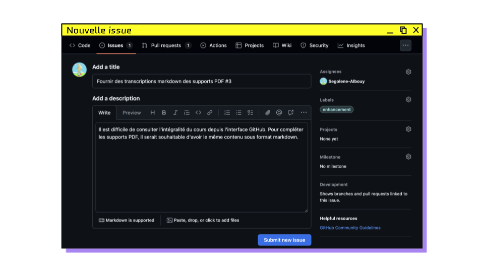
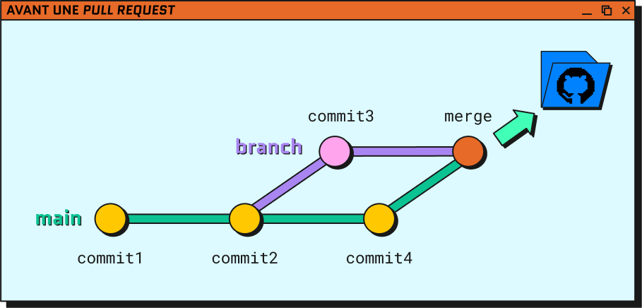
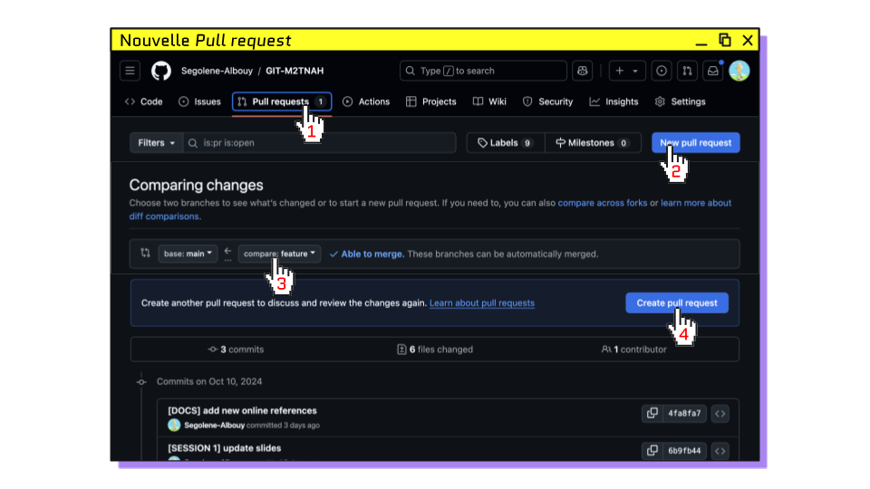
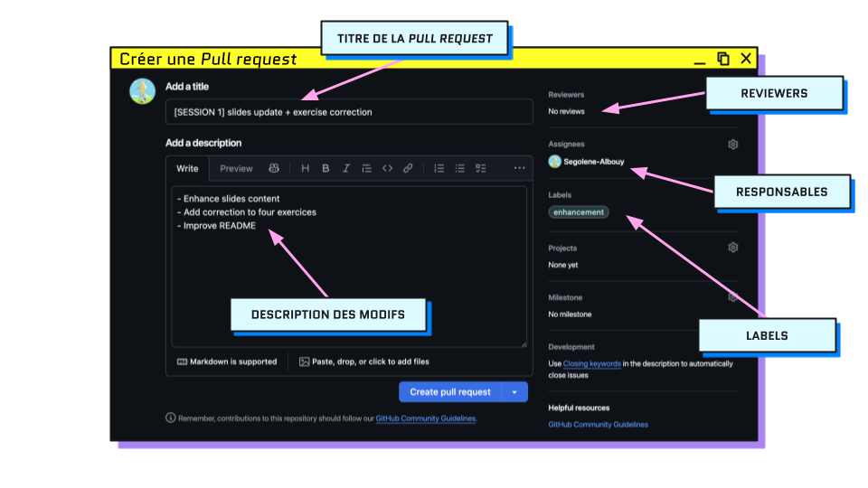
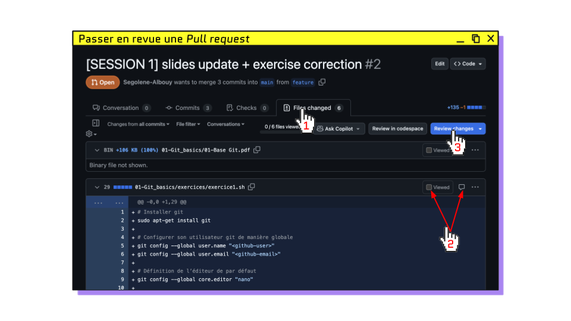
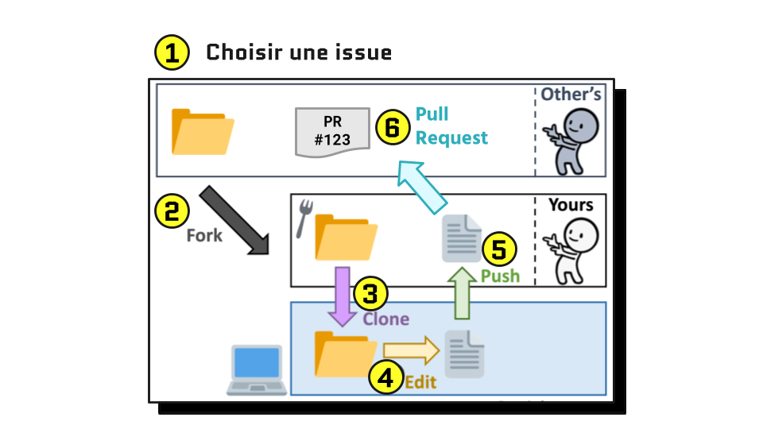
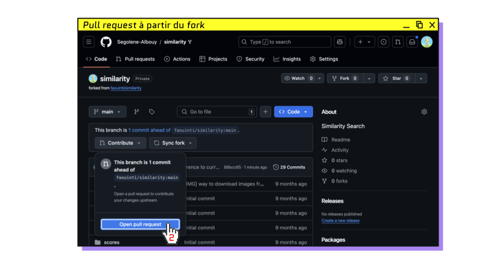

# COLLABORER SUR GITHUB

## Plan du cours

### [▶️ Slides du cours](https://docs.google.com/presentation/d/e/2PACX-1vTlAnfpUqs3283UgymBG-Nu3NbdxftqnA3ddavqas6AodJJP7zu3CHa4ByOeEC71ug4UyL34Q-ZkPJc/pub?start=false&loop=false&delayms=3000)

> 1. [Qui décide ?](#qui-décide-ce-quon-publie-sur-main-) : pourquoi on ne pushe pas directement sur `main`
> 2. [Les issues](#les-issues) : la liste de tâches du projet
> 3. [Les _pull requests_](#les-pull-requests) : proposer sa branche
> 4. [La _review_](#la-review) : relire, suggérer, approuver
> 5. [Après le merge](#après-le-merge) : remettre son `main` à jour
> 6. [Protéger `main`](#protéger-main) : rendre la PR obligatoire
> 7. [Le _fork_](#contribuer-sans-être-collaborateur--le-fork) : contribuer sans être collaborateur
> 8. [S’organiser](#sorganiser--github-flow) : GitHub Flow et stratégie commune
> 9. [Récapitulatif](#ce-que-vous-savez-faire-maintenant)
> 10. [Annexes](#annexes) : modèle de `CONTRIBUTING.md`

<hr>

## Qui décide ce qu'on publie sur `main` ?

> Si deux collaborateurs modifient le même morceau du _repository_,
> qui décide _in fine_ ce qui doit être publié sur la branche `main` ?

Réponse : personne ne pushe directement sur `main`. 
On **propose** la version de sa branche, quelqu’un la **relit**, et seulement ensuite on la **fusionne**. 
On va voir comment faire, en commençant par décider _quoi_ faire.

<hr>

## Les issues

### Qu’est-ce qu’une _issue_ ?


Une _issue_ est un **ticket de discussion public** attaché à un _repository_. On l’utilise pour :

- noter une **tâche** à faire (« Résumer le chapitre 4 »)
- signaler une **erreur** (« Le lien HAL du README renvoie une page 404 »)
- proposer une **amélioration** ou poser une **question**

Chaque _issue_ reçoit un **numéro** (`#1`, `#2`…) qui permet de la citer partout sur GitHub.

> 💡 Dans une équipe, l’onglet _Issues_ sert de **liste de tâches partagée** : on voit ce qui reste à faire, et qui s’en occupe.

<hr>

### Créer une _issue_



Onglet **Issues** > **New issue**

| Champ           | Rôle                                       | Exemple                                                     |
|-----------------|--------------------------------------------|-------------------------------------------------------------|
| **Title**       | la tâche ou le problème, en une phrase     | `Créer une bibliographie commune`                           |
| **Description** | le contexte, ce qui est attendu (Markdown) | `Rassembler dans biblio.md les références de chaque partie` |
| **Assignees**   | la ou les personnes qui s’en chargent      | soi-même                                                    |
| **Labels**      | une catégorie pour filtrer                 | `documentation`, `enhancement`, `bug`                       |

<hr>

### Rédiger une bonne _issue_

1. **Clarté** : décrire précisément la tâche ou le problème, avec un exemple concret
2. **Reproductibilité** : pour une erreur, dire où elle se trouve et comment la constater
3. **Détails** : proposer une solution si on en a une, et ajouter les informations utiles

```md
❌ Titre : problème README
   Description : y a un souci

✅ Titre : Le lien HAL du README renvoie une page 404
   Description :
   Dans `README.md`, ligne 6, le lien HAL pointe vers `enc.hal.science/dumas-0000000`,
   qui affiche « Page introuvable ». Le bon identifiant semble être `dumas-0000001`.
```

<hr>

### Exercice 11 : La liste de tâches du groupe

Dans le _repository_ `note-de-lecture-groupe` de votre groupe, sur GitHub :

1. **Chaque membre** crée une _issue_ décrivant une tâche qui manque à la note de lecture, par exemple :
   - créer `biblio.md` avec les références citées dans sa partie
   - résumer un chapitre encore vide
   - compléter la notice du `README.md` (lien HAL, année de soutenance)
   - uniformiser les titres des fichiers `chapitre-N.md`
2. S’assigner l’_issue_ et lui ajouter un _label_
3. Noter le numéro de son _issue_ : il servira à l’exercice suivant

✅ **RÉUSSI SI** : l’onglet _Issues_ affiche une _issue_ ouverte par membre, chacune assignée

[Correction](./exercices/exercice11.sh)

<hr>

## Les _pull requests_

### Qu’est-ce qu’une _pull request_ ?


Une **_pull request_ (PR)** est une **demande de fusion** d’une branche dans une autre, 
**ouverte à la relecture** avant que la fusion ait lieu.

> 🗒️ Le nom prête à confusion : une _pull request_ n’a rien à voir avec `git pull`. 
> On « demande au propriétaire de récupérer (_pull_) sa branche ». 
> GitLab utilise un nom plus clair : _merge request_.

<hr>

### Le parcours complet d’une contribution



```bash
# 0. Partir de la dernière version de main
[main] git pull

# 1. Créer une branche pour la tâche (nommée d’après l’issue)
[main] git switch -c biblio-commune

# 2. Travailler et commiter
[biblio-commune] git add biblio.md
[biblio-commune] git commit -m "feat(biblio): ajout des références de la partie 2"

# 3. Synchroniser : intégrer ce qui a été publié sur main entre-temps
[biblio-commune] git fetch
[biblio-commune] git merge origin/main

# 4. Publier sa branche
[biblio-commune] git push -u origin biblio-commune

# 5. Ouvrir la pull request sur GitHub
```

> **Pourquoi `origin/main` et pas `main` ?** 
> Votre `main` local n’est mis à jour que par `git pull` : il peut être en retard sur GitHub. 
> `git fetch` met à jour `origin/main`, la copie de l’état de `main` sur GitHub (cours 2). 
> Fusionner `origin/main` garantit de se synchroniser avec la **vraie** dernière version.

> 💡 **Dans VSCode** : _Publish Branch_ dans _Source Control_ publie la branche, 
> puis une notification propose **_Create Pull Request_**.

<hr>

### ⚠️ À retenir : _synchroniser avant de merger_

Si `main` a avancé pendant que vous travailliez, les conflits éventuels apparaissent **sur votre branche**, 
où vous les résolvez tranquillement et non au moment de la fusion dans `main`.

<hr>

### Ouvrir une _pull request_ sur GitHub



1. Onglet **Pull requests** > **New pull request**
2. **base** : la branche qui reçoit (`main`) ← **compare** : votre branche
3. GitHub indique **_Able to merge_** si aucun conflit n’est détecté
4. **Create pull request**

> 💡 Juste après un push, GitHub affiche aussi un bandeau jaune **_Compare & pull request_** sur la page du _repository_.

<hr>

### Remplir la _pull request_



| Champ           | Rôle                                                             |
|-----------------|------------------------------------------------------------------|
| **Title**       | ce que fait la PR, avec la convention `type(scope): description` |
| **Description** | ce qui a changé, pourquoi, et l’_issue_ résolue (`Closes #N`)    |
| **Reviewers**   | la ou les personnes à qui on demande une relecture               |
| **Assignees**   | la personne responsable de la PR                                 |
| **Labels**      | la même catégorie que l’_issue_                                  |

Exemple :

```md
Titre : feat(biblio): création de la bibliographie commune

Description :
- ajout de `biblio.md`
- références de la partie 2 au format auteur, titre, année

Closes #3
```

<hr>

### Fermer une _issue_ automatiquement

Un **mot-clé** suivi du numéro de l’_issue_ ferme celle-ci automatiquement **quand la PR est mergée** :

| Mots-clés                         | Exemple        |
|-----------------------------------|----------------|
| `close`, `closes`, `closed`       | `Closes #3`    |
| `fix`, `fixes`, `fixed`           | `Fixes #3`     |
| `resolve`, `resolves`, `resolved` | `Resolves #3`  |

Où écrire le mot-clé :
- ✅ dans la **description** de la PR (recommandé : l’_issue_ et la PR sont alors liées)
- ✅ dans un **message de commit** : `git commit -m "fix(readme): correction du lien HAL (fixes #4)"`
- ❌ pas dans le **titre** de la PR

> ⚠️ Cela ne fonctionne que si la PR cible la branche par défaut du _repository_ (`main`).

🔗 [Doc GitHub](https://docs.github.com/en/issues/tracking-your-work-with-issues/using-issues/linking-a-pull-request-to-an-issue)

<hr>

### 😭 GitHub affiche _This branch has conflicts that must be resolved_ !

`main` a reçu des modifications sur les mêmes lignes que votre branche, depuis votre dernière synchronisation.

**Solution** : se synchroniser à nouveau, en local, puis republier. La PR se met à jour toute seule.

```bash
[my-branch] git fetch
[my-branch] git merge origin/main
# résoudre le conflit dans le Merge Editor, puis Complete Merge et Continue
[my-branch] git push
```

<hr>

## La _review_

### Pourquoi relire ?

La _review_ est le moment où **un deuxième regard** vérifie la PR avant qu’elle n’arrive sur `main`. 
Elle sert aussi à apprendre : on découvre le travail et les façons de faire des autres.

1. **Review** : un·e collaborateur·ice lit les modifications
2. **Discussion** : commentaires et suggestions, l’auteur·ice corrige
3. **Validation** : une fois approuvée, la PR est mergée

<hr>

### Que vérifier ?

| Critère      | Questions à se poser                                                                         |
|--------------|----------------------------------------------------------------------------------------------|
| **Objectif** | La PR fait-elle ce que décrit l’_issue_ ? Seulement ça ?                                     |
| **Qualité**  | Le format est-il respecté (5 points, titres) ? L’orthographe ? Les messages de commit ?      |
| **Vérifier** | L’aperçu Markdown s’affiche-t-il bien ? Les liens fonctionnent-ils ? Aucun `brouillon.txt` ? |

⚠️ **Avant d’approuver une PR**, on lit au minimum **l’ensemble de l’onglet _Files changed_**.

<hr>

### Relire une PR sur GitHub



1. Onglet **Files changed** : toutes les modifications, au format `git diff`
2. Survoler une ligne puis cliquer sur **+** pour la commenter
3. Cocher **Viewed** pour chaque fichier relu
4. **Review changes** pour envoyer sa relecture, avec l’une des trois décisions :

| Décision            | Signification                                   |
|---------------------|-------------------------------------------------|
| **Comment**         | remarque générale, sans se prononcer            |
| **Approve**         | la PR peut être mergée                          |
| **Request changes** | des corrections sont nécessaires avant le merge |

<hr>

### Proposer une correction : la _suggestion_

En commentant une ligne, l’icône **±** (_Add a suggestion_) insère un bloc où l’on réécrit la ligne :

````md
Il manque l’année de publication :
```suggestion
- Dupont, M., _Les manuscrits enluminés_, 2019
```
````

L’auteur·ice de la PR clique sur **_Commit suggestion_** : GitHub crée le commit à sa place, sur la branche de la PR.

<hr>

### Corriger sa PR après une _review_

Pas besoin d’ouvrir une nouvelle PR : **on continue à commiter sur la même branche, et on pushe**. 
La PR affiche automatiquement les nouveaux commits.

```bash
[biblio-commune] git commit -am "fix(biblio): ajout des années manquantes"
[biblio-commune] git push
```

<hr>

### Merger la PR

Une fois la PR approuvée :

1. Bouton **Merge pull request** (option **_Create a merge commit_**)
2. **Confirm merge** : GitHub crée un commit `Merge pull request #N from ...` sur `main`
3. **Delete branch** : la branche a rempli son rôle

<hr>

## Après le merge

La fusion a eu lieu **sur GitHub**. Sur votre ordinateur, `main` n’a pas bougé : il est **en retard**.

```bash
# Revenir sur main et récupérer le merge
[biblio-commune] git switch main
[main] git pull

# Supprimer la branche locale, désormais fusionnée
[main] git branch -d biblio-commune
```

<hr>

### L’extension _GitHub Pull Requests_ pour VSCode

L’extension [**GitHub Pull Requests**](https://marketplace.visualstudio.com/items?itemName=GitHub.vscode-pull-request-github) 
permet de créer, relire et commenter les PR et les _issues_ sans quitter VSCode. 
Elle demande de se connecter à son compte GitHub dans VSCode.

<hr>

### Exercice 12 : Résoudre son _issue_ avec une PR (par groupe)

1. Sur `main`, récupérer la dernière version du _repository_
2. Créer une branche nommée d’après son _issue_ (ex. `biblio-commune`) et s’y déplacer
3. Réaliser la tâche décrite dans l’_issue_, puis ajouter et commiter avec un message au top
4. Se synchroniser avec la dernière version de `main` publiée sur GitHub
5. Publier sa branche
6. Ouvrir une PR vers `main` : titre conventionnel, `Closes #N` dans la description, un·e camarade en _reviewer_
7. Relire la PR d’un·e camarade dans _Files changed_ : au moins **un commentaire** et **une suggestion**, 
   puis envoyer la _review_ avec **Request changes**
8. Sur sa propre PR : accepter la suggestion reçue, faire les autres corrections et les publier
9. Le ou la _reviewer_ approuve la PR
10. Merger sa PR, supprimer la branche, puis mettre à jour son `main` local

> _Ouvrez l’onglet Issues : que s’est-il passé ? Pourquoi ?_

✅ **RÉUSSI SI** : toutes les _issues_ du groupe sont fermées, et `git log --oneline --graph` 
affiche un commit `Merge pull request #N` par membre

[Correction](./exercices/exercice12.sh)

<hr>

## Protéger `main`

Jusqu’ici, la PR est une **convention** : rien n’empêche encore un collaborateur de pusher directement sur `main`. 
GitHub permet de la rendre **obligatoire**.

**Settings** > **Branches** > ajouter une règle de protection pour `main`, et cocher :
- **Require a pull request before merging**
- **Require approvals** : 1

Puis tenter un push direct sur `main` :

```bash
[main] git commit -am "test: push direct"
[main] git push

remote: error: GH006: Protected branch update failed for refs/heads/main.
```

GitHub refuse : la seule porte d’entrée de `main` est désormais une PR approuvée.

<hr>

## Contribuer sans être collaborateur : le _fork_

### Le problème

Vous avez repéré une coquille dans la note de lecture d’un **autre groupe**. Vous clonez leur _repository_, corrigez, commitez… et :

```bash
$ git push
ERROR: Permission to autre-groupe/note-de-lecture-groupe.git denied to <github-user>.
fatal: Could not read from remote repository.
```

**Pourquoi ?** Vous n’êtes pas collaborateur : vous pouvez **lire** un _repository_ public, mais pas y **écrire**. 
C’est ce qui permet aux projets _open-source_ de rester sous le contrôle de leurs mainteneurs.

**Donc** on travaille sur sa propre copie, puis on propose ses modifications par une PR.

<hr>

### Qu’est-ce qu’un _fork_ ?

Un **_fork_** est une **copie d’un _repository_ GitHub sur son propre compte**. 
Vous y avez tous les droits : vous pouvez y pusher librement, sans toucher au _repository_ d’origine.

|                       | `git clone`            | _fork_                      |
|-----------------------|------------------------|-----------------------------|
| **Où va la copie ?**  | sur votre ordinateur   | sur votre compte GitHub     |
| **Outil**             | git (terminal, VSCode) | GitHub (bouton _Fork_)      |
| **Pour quoi faire ?** | travailler en local    | avoir un _remote_ où pusher |

On fait donc les deux : _fork_ sur GitHub, puis _clone_ du _fork_ en local.

<hr>

### Le parcours d’une contribution externe



1. **Issue** : trouver ou créer une _issue_ sur le _repository_ d’origine
2. **Fork** : bouton **Fork** en haut à droite du _repository_
3. **Clone** : cloner **son _fork_** (et non l’original) en local
4. **Edit** : créer une branche, modifier, commiter
5. **Push** : publier sur **son _fork_**
6. **Pull request** : ouvrir une PR **du _fork_ vers le _repository_ d’origine**

<hr>

### Ouvrir une PR depuis un _fork_



Sur la page de son _fork_ : **Contribute** > **Open pull request**. 
GitHub affiche alors **quatre** menus au lieu de deux :

```
base repository: autre-groupe/note-de-lecture-groupe   base: main
          ← head repository: <github-user>/note-de-lecture-groupe   compare: fix-lien-hal
```

- **base** : là où les modifications doivent arriver (le _repository_ d’origine)
- **head** : d’où elles viennent (votre _fork_)

> 💡 **Sync fork** met votre _fork_ à jour avec le _repository_ d’origine, 
> si celui-ci a avancé depuis la création du _fork_.

<hr>

### Les _issues_ dans un projet _open-source_


Sur un projet _open-source_, les _issues_ indiquent **où et comment contribuer** :
- le fichier **`CONTRIBUTING.md`** décrit les règles du projet : à lire avant toute contribution
- le _label_ **`good first issue`** signale les tâches adaptées aux nouveaux contributeurs
- avant de commencer, on commente l’_issue_ pour signaler qu’on s’en occupe

<hr>

### Exercice 13 : Corriger la note d’un autre groupe (groupe × groupe)

1. Sur GitHub, lire la note de lecture d’un autre groupe et y repérer une amélioration
   (coquille, lien manquant, référence incomplète)
2. Créer une _issue_ sur **leur** _repository_ qui décrit précisément le problème (fichier, ligne, correction proposée)
3. _Forker_ leur _repository_
4. Cloner **son _fork_** en local (⚠️ hors d’un autre _repository_) et l’ouvrir dans VSCode
5. Créer une branche `fix-<sujet>`, corriger, commiter avec un message au top 💯
6. Publier la branche sur son _fork_
7. Ouvrir une PR vers le _repository_ d’origine, avec `Fixes #N` dans la description
8. **Le groupe propriétaire** relit la PR, l’approuve et la merge

✅ **RÉUSSI SI** : l’_issue_ est fermée sur le _repository_ de l’autre groupe, et votre commit apparaît dans son historique

[Correction](./exercices/exercice13.sh)

<hr>

## S’organiser : GitHub Flow

### Un modèle simple pour toute l’équipe

Tout ce que vous avez fait aujourd’hui porte un nom : le **GitHub Flow**.

```
main   ●───────────●────────────────●──────────▶   toujours propre
        \         /  \              /
         ●──●──●─●    ●──●──●──●───●
        biblio-commune  fix-lien-hal
        ↑ issue #3      ↑ issue #4
```

1. `main` contient toujours une version **propre** et partageable
2. Chaque tâche a sa **branche**, au nom explicite, créée depuis `main` à jour
3. On **commite** régulièrement sur sa branche
4. On ouvre une **PR** dès qu’on veut un retour
5. On **relit** et on discute dans la PR
6. Une fois approuvée, on **merge** et on supprime la branche

<hr>

### Définir une stratégie commune

Pour que le GitHub Flow fonctionne, l’équipe s’accorde sur quelques règles, écrites dans un `CONTRIBUTING.md` :

| Règle                     | Exemple                                                        |
|---------------------------|----------------------------------------------------------------|
| **Nom des branches**      | `feat/<sujet>`, `fix/<sujet>`                                  |
| **Messages de commit**    | `type(scope): description` (cours 1)                           |
| **_Pull requests_**       | `Closes #N` dans la description, 1 approbation minimum         |
| **Fréquence des commits** | un commit = une modification résumable en une phrase (cours 1) |
| **Branche `main`**        | protégée : on n’y entre que par une PR                         |

📄 [Modèle de `CONTRIBUTING.md`](./templates/CONTRIBUTING.md)

<hr>

### Interro surprise ! 😱

🗳️ [Quiz : récapitulatif du cours](https://segolene-albouy.github.io/GIT-M2TNAH/quiz/?quiz=git-3)

<hr>

## Ce que vous savez faire maintenant

1. ✅ Décrire une tâche ou un problème dans une _issue_
2. ✅ Proposer une branche avec une _pull request_ et y lier une _issue_
3. ✅ Relire une PR : commenter, suggérer, approuver
4. ✅ Corriger sa PR et la merger, puis remettre son `main` à jour
5. ✅ Contribuer à un _repository_ dont on n’est pas collaborateur grâce au _fork_
6. ✅ Organiser le travail d’une équipe avec le GitHub Flow
